# Анализ базы данных Front (MS SQL Server)

Архитектурно таблицы делятся на два модуля:
- **Front Office** (без префикса): `journal`, `transtype`, `receiptnlist`, `personnel`,
  `vendors`, `product`, `stock`, `onhand` - касса, продажи, справочники;
- **Back Office** (префикс `bm_`): `bm_StorageOperations`, `bm_StorageOperationsType`,
  `bm_JournalSessions`, `bm_ShiftsOperations`, `bm_WorkHours`, `bm_Contracts` -
  склад, документы, журналирование.

### Сводка ключевых находок

| № | Находка | Где подтверждено |
|---|---|---|
| 1 | Знаковая модель движений: приход «+», списание «-» | 1.1 |
| 2 | Концентрация закупок: лидер ≈49% объёма | 3.2 |
| 3 | Договоры не ведутся: bm_Contracts пуста | 3.3 |
| 4 | Сессии почти целиком - служебная учётка Barnet (47.9% ошибок) | 4.2 |
| 5 | Остатки не ведутся: снимки пусты, Rest = 0, балансы отрицательные | 5.1–5.3 |

---

## 1. Анализ закупки продукции

### Основные таблицы
- **bm_StorageOperations** - строки движений товаров (факты закупок и списаний).

### Связанные таблицы и связи
- **bm_StorageOperationsType** - тип операции: `bm_StorageOperations.OperationID → bm_StorageOperationsType.ID`.
- **product** - товар: `bm_StorageOperations.ProductID → product.id`.
- **vendors** - поставщик: `bm_StorageOperations.VendorID → vendors.id`.

### Описание таблиц

#### bm_StorageOperations - движения товаров (основная)
| Колонка | Назначение | Пример данных |
|---|---|---|
| `ID` | ключ строки движения | 1031198 строк всего |
| `DocumentID` | идентификатор документа; строки с общим значением образуют документ | 50416 уникальных |
| `OperationID` | ссылка на тип операции | 1 = «Поступление» |
| `ProductID` | ссылка на товар | сыр «Голландский, моцарелла» |
| `VendorID` | ссылка на поставщика | 211 = «Пятая Армия» |
| `ContractID` | ссылка на договор | - |
| `StorageID` | ссылка на место хранения | - |
| `Price` / `PriceCost` | цена и себестоимость единицы | - |
| `Quantity` | количество в упаковке (не заполнено) | 0.000 |
| `Count` | количество со знаком: приход «+», списание «-» | 12733.937 |
| `Rest` | остаток после операции (не заполнен) | 0.000 |
| `Amount` | сумма операции со знаком | 4046169.91 |
| `DateAdd` | дата и время операции | 2023-12-04 16:00:51 |

#### bm_StorageOperationsType - типы операций
| Колонка | Назначение | Пример данных |
|---|---|---|
| `ID` | код типа операции | 1 |
| `Description` | название типа | «Поступление», «Списание» |
| `Factor` | знак/коэффициент типа | - |

#### product - справочник товаров
| Колонка | Назначение | Пример данных |
|---|---|---|
| `id` | код товара | - |
| `description` | наименование | «Сыр Голландский, моцарелла» |
| `onhand` | остаток в каталоге (не заполнен) | NULL у 1545 из 1545 |

#### vendors - справочник поставщиков
| Колонка | Назначение | Пример данных |
|---|---|---|
| `id` | код поставщика | 211 |
| `lastname` | наименование | «Пятая Армия» |
| `clientgroup` | ссылка на группу | «Поставщики» |

### ER-диаграмма
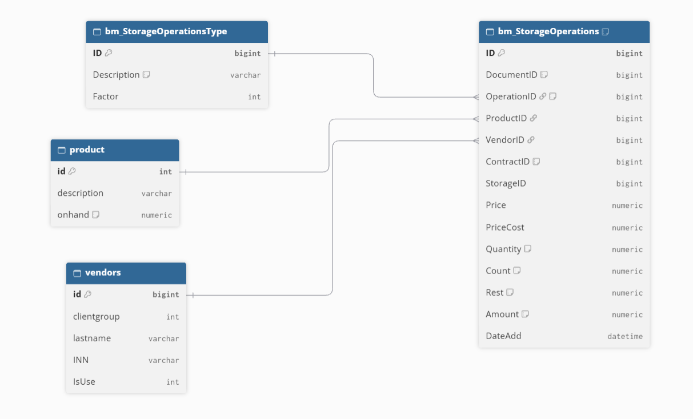

### Запросы и результаты

#### Запрос 1.1 - Объёмы по годам и типам операций
*Что показывает:* годовую динамику поступлений и списаний в количестве и сумме;
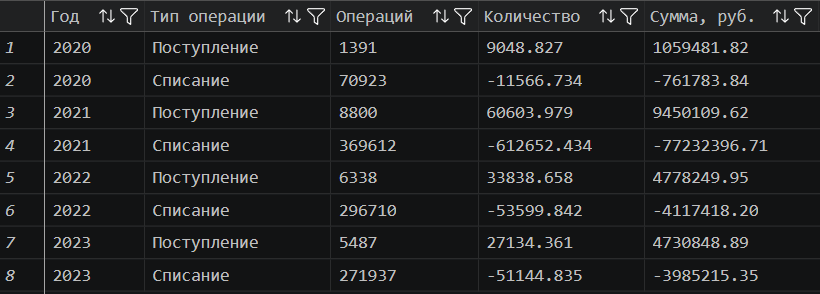

*Вывод:* поступления 2020–2023 ≈ 20.02 млн руб. (2020: 1.06 млн / 1391 строк;
2021: 9.45 млн / 8800; 2022: 4.78 млн / 6338; 2023: 4.73 млн / 5487).

#### Запрос 1.2 - Топ-10 закупаемых товаров
*Что показывает:* структуру закупок в разрезе номенклатуры.
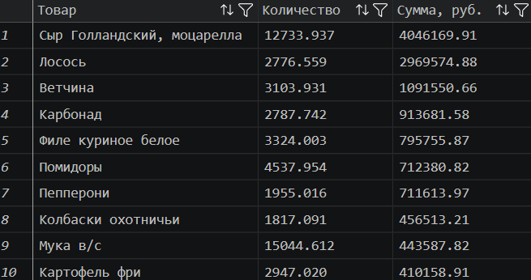

*Вывод:* лидер закупок - «Сыр Голландский, моцарелла»: 12733.937 шт. на 4.05 млн руб.

### Выводы по группе
1. Движения хранятся по знаковой модели; колонка `Quantity` не ведётся, бизнес-количество - в `Count`.
2. Пик закупок - 2021 год (9.45 млн руб.), далее объём стабилизировался (~4.7–4.8 млн/год).
---

## 2. Анализ продажи товара

### Основные таблицы
- **journal** - строки чеков.
- **bm_Journal_Details** — бэк-офисная детализация продаж (Back Office): разложение
  чеков на товары/ингредиенты по рецептам; структурный мост «продажи → склад».

### Связанные таблицы и связи
- **transtype** - тип транзакции: `journal.transtype → transtype.transtypeid`.
- **product** — товар/ингредиент: `bm_Journal_Details.ProductID → product.id`.
- **storages** — место хранения: `bm_Journal_Details.StorageID → storages.id`.
- **receiptnlist** - вспомогательный реестр номеров (25 строк, диапазон 9000000x).

### Описание таблиц

#### journal - строки чеков (основная)
| Колонка | Назначение | Пример данных |
|---|---|---|
| `storeid` / `posid` | магазин и касса | 0 / 0 |
| `transtype` | ссылка на тип транзакции | 101 = «PLU Sales» |
| `receiptn` | номер чека, ключ на шапку receiptnlist | 90000001 |
| `dater` | дата и время операции | 2021 (год пика) |
| `description` | наименование позиции | «Пирог Камиль слоеный» |
| `quantity` | количество позиции | 2.000 |
| `price` / `amount` | цена и сумма позиции | 450.00 |
| `categoryid` | код категории позиции | LIQ |
| `loginid` | логин кассира | - |
| `cost` | себестоимость позиции | - |

#### bm_Journal_Details — детализация продаж
| Колонка | Назначение | Пример данных |
|---|---|---|
| `ID` | ключ строки детализации | — (данные не извлекались) |
| `SourceID` | идентификатор строки-источника (гипотеза: journal.transnumber) | — |
| `ProductID` | ссылка на товар/ингредиент | — |
| `BludoID` | идентификатор блюда (рецептурная развёртка) | — |
| `sBrutto` | служебное поле состава (семантика не анализировалась) | — |
| `Quantity` | количество в рецептурных единицах | — |
| `Count` | количество в складских единицах | — |
| `TicketNumber` | номер чека (гипотеза: journal.receiptn) | — |
| `RangeID` / `SizeID` | идентификаторы диапазона и размера | — |
| `DateAdd` | дата и время операции | — |
| `StorageID` | ссылка на место хранения | — |
| `DepartmentID` | идентификатор подразделения | — |

#### transtype - типы транзакций
| Колонка | Назначение | Пример данных |
|---|---|---|
| `transtypeid` | код типа | 101 |
| `transgroupid` | группа типов (1 - продажи, 2 - оплаты, 3 - служебные) | 1 |
| `description` | название типа | «PLU Sales», «Cash», «Login» |

#### product — справочник товаров
| Колонка | Назначение | Пример данных |
|---|---|---|
| `id` | код товара | — |
| `description` | наименование | «Сыр Голландский, моцарелла» |
| `onhand` | остаток в каталоге (не заполнен) | NULL у 1545 из 1545 |

#### receiptnlist - вспомогательный реестр номеров
| Колонка | Назначение | Пример данных |
|---|---|---|
| `receiptn` | номер из служебного реестра | 90000001, 90000002, 90000003 |

### ER-диаграмма
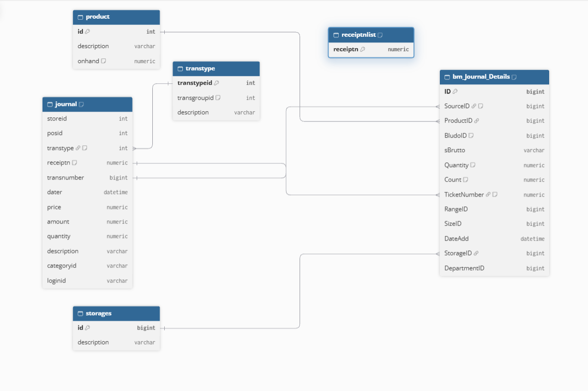

### Запросы и результаты

#### Запрос 2.1 - Продажи по годам
*Что показывает:* выручку, число чеков и строк, средний чек по годам.
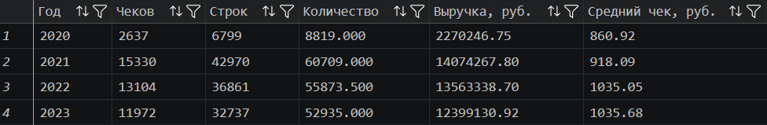

*Вывод:* 2020 - 2.27 млн руб. / 2637 чеков; 2021 - 14.07 млн / 15330;
2022 - 13.56 млн / 13104; 2023 - 12.40 млн / 11972. Пик - 2021 год.

#### Запрос 2.2 - Топ-10 товаров по выручке
*Что показывает:* лидеров продаж.

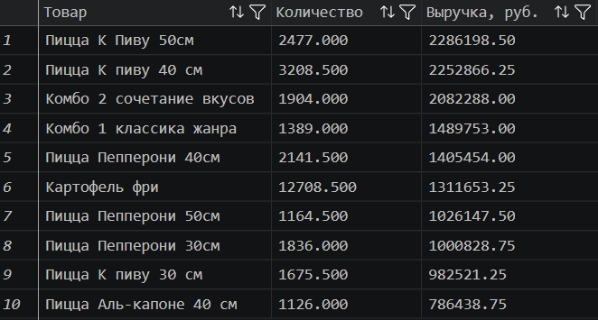

*Вывод:* лидеры - «Пицца К Пиву 50см» (2.29 млн руб.), «Пицца К пиву 40 см»
(2.25 млн), «Комбо 2» (2.08 млн). Выручка сконцентрирована на пицце и комбо-наборах.

#### Запрос 2.3 - Способы оплаты
*Что показывает:* распределение оплат по типам группы 2 (наличные/карты).
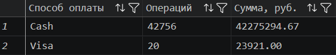

*Вывод:* большая доля транзакций идет через наличку.

### Выводы по группе
1. Продажи хранятся в два слоя: кассовый `journal` и бэк-офисная рецептурная детализация `bm_Journal_Details`; аналитика выручки выполнена по кассовому слою.
2. В чеках есть служебные строки-комментарии с нулевой суммой — в топах исключены.

---

## 3. Анализ взаимоотношений с поставщиками

### Основные таблицы
- **vendors** - справочник поставщиков.

### Связанные таблицы и связи
- **vendorgroup** - группы: `vendors.clientgroup → vendorgroup.vendorgroupid`.
- **bm_Contracts** - договоры: `bm_Contracts.VendorID → vendors.id` (таблица пуста).
- **bm_Companies** - юрлица: `bm_Contracts.CompanyID → bm_Companies` (1 строка).
- **bm_StorageOperations** - движения закупок: `bm_StorageOperations.VendorID → vendors.id`.

### Описание таблиц

#### vendors - поставщики (основная)
| Колонка | Назначение | Пример данных |
|---|---|---|
| `id` | код поставщика | 211 |
| `lastname` / `firstname` | наименование / имя | «Пятая Армия» |
| `clientgroup` | ссылка на группу | «Поставщики», «Без названия» |
| `INN` / `KPP` / `OGRN` | реквизиты | ИНН у 5 из 63; КПП - 0 |
| `teln` / `emaliaddress` | контакты | - |
| `contactperson` | контактное лицо | не заполнено ни у кого |
| `IsUse` | флаг активности | 20 активных из 63 |

#### vendorgroup - группы поставщиков
| Колонка | Назначение | Пример данных |
|---|---|---|
| `vendorgroupid` | код группы | - |
| `description` | название группы | «Поставщики», «Без названия» |
| `flag` | признак группы | - |

#### bm_Contracts - договоры
| Колонка | Назначение | Пример данных |
|---|---|---|
| `ID` | ключ договора | таблица пуста (0 строк) |
| `VendorID` | ссылка на поставщика | - |
| `CompanyID` | ссылка на юрлицо | - |
| `ContractNumber` / `Period` | номер и дата договора | - |

### ER-диаграмма
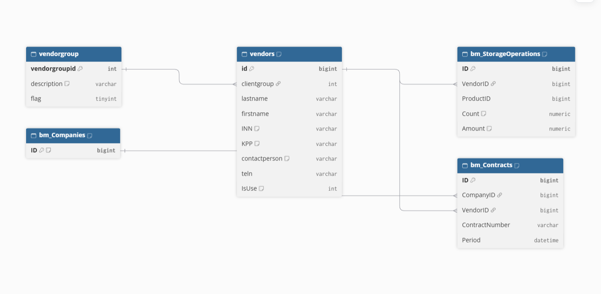

### Запросы и результаты

#### Запрос 3.1 - Портфель поставщиков: полнота и активность
*Что показывает:* сколько карточек ведётся и насколько заполнены реквизиты.

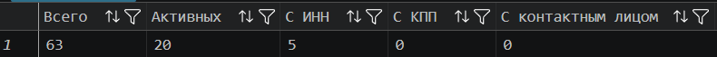

*Вывод:* 63 поставщика, активных 20; ИНН у 5, КПП и контактное лицо - ни у одного.
Реквизиты в системе фактически не ведутся.

#### Запрос 3.2 - Топ-10 поставщиков с долей в объёме
*Что показывает:* концентрацию закупок; доля считается оконной функцией от общего объёма.

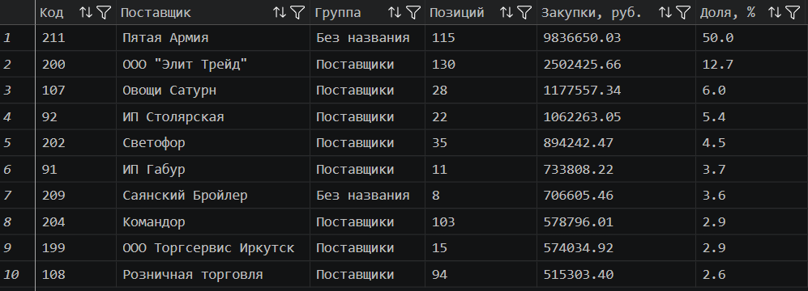

*Вывод:* лидер №211 «Пятая Армия» - 9.84 млн руб. (≈49%); №200 «Элит Трейд» - 12.7%;
далее 6.0 / 5.4 / 4.5 / 3.7 / 3.6 / 2.9 / 2.9 / 2.6%. Топ-10 закрывает свыше 90% объёма -
высокий риск зависимости от одного поставщика.

#### Запрос 3.3 - Формализация отношений: договоры и юрлица
*Что показывает:* заполненность `bm_Contracts` и `bm_Companies`.

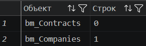

*Вывод:* `bm_Contracts` - 0 строк, `bm_Companies` - 1 строка. Договорные отношения
в БД не формализованы; анализ строится на движениях закупок.

### Выводы по группе
1. Портфель «раздут»: две трети карточек неактивны, реквизиты не заполнены.
2. Закупки критически сконцентрированы на лидере (≈49%).
3. Договоры не ведутся; единственное юрлицо в `bm_Companies`.

---

## 4. Анализ работы персонала

### Основные таблицы
- **personnel** - справочник сотрудников.

### Связанные таблицы и связи
- **bm_JournalSessions** - сессии и ошибки: `bm_JournalSessions.PersonID → personnel.personid`.
- **bm_ShiftsOperations** - сменные операции: `bm_ShiftsOperations.PersonalID → personnel.personid`.
- **bm_WorkHours** - отработанные часы: `bm_WorkHours.PersonID → personnel.personid`.

### Описание таблиц

#### personnel - сотрудники (основная)
| Колонка | Назначение | Пример данных |
|---|---|---|
| `personid` | код сотрудника | 897, 990, 993 |
| `lastname` / `firstname` | ФИО | «Горбатенко Кристина» |
| `securityaccess` | уровень доступа | 1 (102 чел.), 9 (5), 3 (2) |
| `flagpos` | право работы на кассе | установлен у 12 из 109 |
| `flagsales` / `flagreports` | права продаж / отчётов | не установлены никому |
| `deleteflag` | флаг удаления; равен 1 у всех 109 строк (особенность данных) | 1 |

#### bm_JournalSessions - журнал сессий
| Колонка | Назначение | Пример данных |
|---|---|---|
| `ID` | ключ записи | 174072 строки всего |
| `PersonID` | ссылка на сотрудника | 897 |
| `Type` | тип события | - |
| `Message` | текст события | - |
| `IsError` | признак ошибки | 75222 ошибки у учётки Barnet |
| `DateAdd` | дата и время события | - |
| `UserAdd` | логин инициатора | - |

#### bm_ShiftsOperations / bm_WorkHours - смены и часы
| Колонка | Назначение | Пример данных |
|---|---|---|
| `PersonalID` (Shifts) / `PersonID` (Hours) | ссылка на сотрудника | - |
| `ShiftNumber` / `ShiftID` | номер смены | - |
| `SystemPeriod` / `ManualPeriod` (Hours) | часы системные / ручные | таблица пуста (0 строк) |

### ER-диаграмма
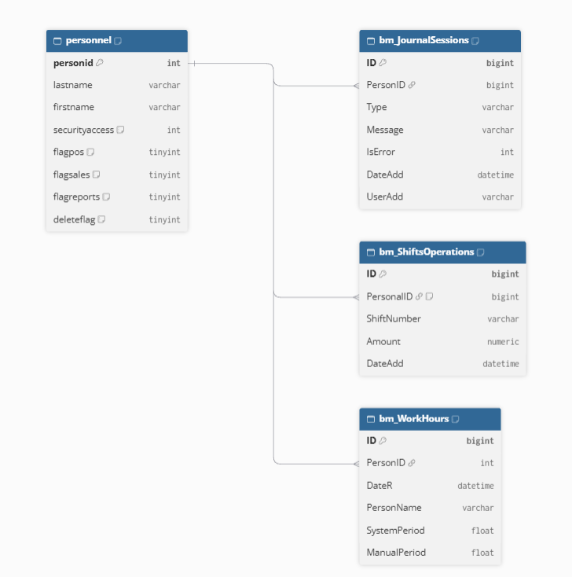

### Запросы и результаты

#### Запрос 4.1 - Уровни доступа и права
*Что показывает:* распределение сотрудников по уровням и флагам прав.

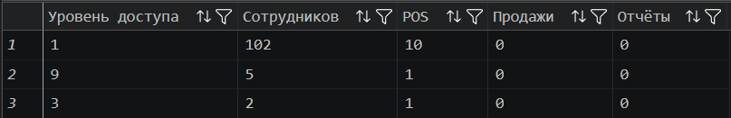

*Вывод:* 3 уровня доступа (1 - 102 чел., 9 - 5, 3 - 2); флаг POS у 12 человек;
флаги продаж и отчётов - нули у всех. Разграничение прав формальное.

#### Запрос 4.2 - Активность: сессии и доля ошибок
*Что показывает:* кто реально работает в системе и какова доля ошибок.

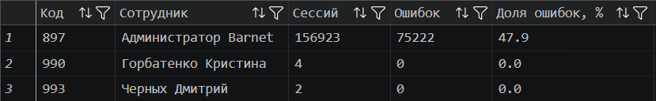

*Вывод:* сессии есть у 3 сотрудников; 156923 сессии и 75222 ошибки (47.9%) -
у служебной учётки «Администратор Barnet».

### Выводы по группе
1. Активность фиксируется только в `bm_JournalSessions`; смены и часы отсутствуют.
2. Основной объём журнала - служебная учётка Barnet; её ошибки не характеризуют персонал.
3. Права настроены минимально; `deleteflag` не несёт смысловой нагрузки.

---

## 5. Анализ остатков

### Основные таблицы
- **bm_StorageOperations** + **bm_StorageOperationsType** - движения (единственный источник данных об остатках).

### Связанные таблицы и связи
- **onhand** - POS-витрина остатков: `onhand.productid → product.id` (пуста).
- **stock** - каталожные остатки: `stock.productid → product.id`, `stock.storageid → storages.id` (пуста).
- **storagesonhand** - остатки по местам хранения: `storagesonhand.storageid → storages.id`, `storagesonhand.productid → product.id` (пуста).
- **storages** - места хранения: справочник.
- **product.onhand** - колонка остатка в каталоге (не заполнена).

### Описание таблиц

#### bm_StorageOperations - движения (источник для восстановления остатков)
| Колонка | Назначение | Пример данных |
|---|---|---|
| `Count` | движение со знаком | -68093.372 (списание сыра) |
| `Rest` | остаток после операции (не заполнен) | 0.000 |
| `OperationID` | тип операции | «Поступление» / «Списание» |

#### onhand / stock / storagesonhand - снимки остатков
| Колонка | Назначение | Пример данных |
|---|---|---|
| `onhand` | текущий остаток | таблицы пусты (0 строк) |
| `productid` | ссылка на товар | - |
| `storageid` (stock, storagesonhand) | ссылка на место хранения | - |

#### storages - места хранения
| Колонка | Назначение | Пример данных |
|---|---|---|
| `id` | код места хранения | - |
| `description` | название | - |
| `CompanyID` / `DepartmentID` | принадлежность | - |

### ER-диаграмма
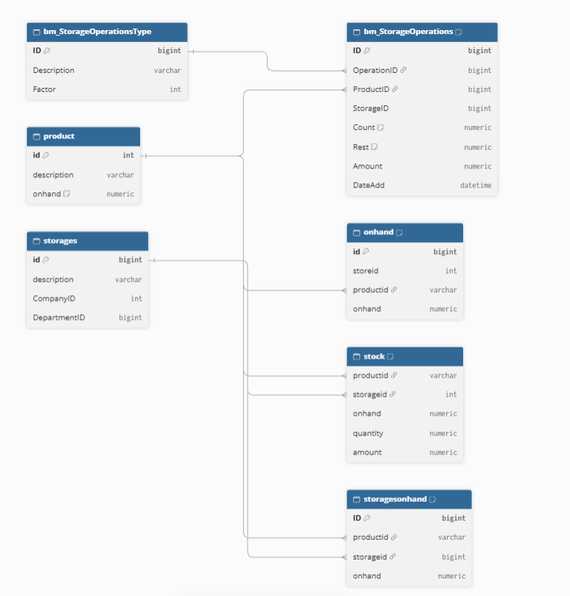

### Запросы и результаты

#### Запрос 5.1 - Баланс по товарам из движений
*Что показывает:* приход, списание и знаковый баланс по товару.

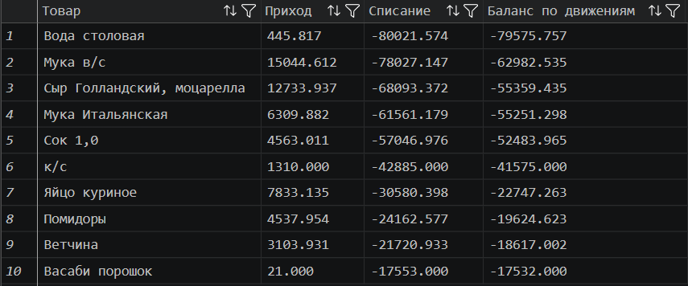

*Вывод:* балансы топовых товаров отрицательные: «Сыр Голландский, моцарелла»
12733.937 - 68093.372 = -55359.435; «Мука Итальянская» -55251.298; «Сок 1,0» -52483.965.
Отрицательный остаток физически невозможен - в движениях нет начальных остатков.

#### Запрос 5.2 - Rest последней операции по товару
*Что показывает:* последний известный остаток из колонки `Rest`.

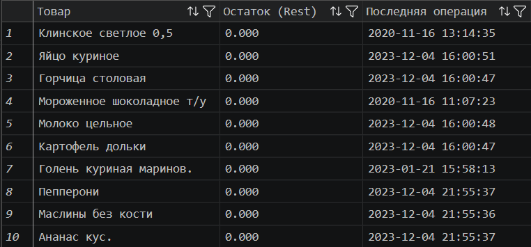

*Вывод:* `Rest = 0.000` во всех строках. Последних известных остатков нет.

#### Запрос 5.3 - Где живут остатки: счётчики источников
*Что показывает:* заполненность всех таблиц-снимков и каталожной колонки.

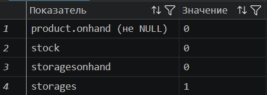

*Вывод:* `onhand` = 0, `stock` = 0, `storagesonhand` = 0; `product.onhand` NOT NULL - 0. Остатки не ведутся нигде.

### Выводы по группе
1. Учёт остатков в БД не ведётся: снимки пусты, `Rest` и `product.onhand` не заполнены.
2. Балансы из движений отрицательные из-за отсутствия начальных остатков.
3. Корректный текущий остаток получить невозможно; анализ остатков ограничен оборотами.
